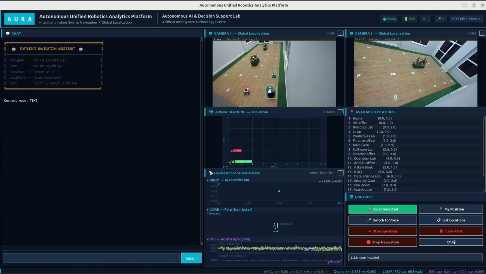
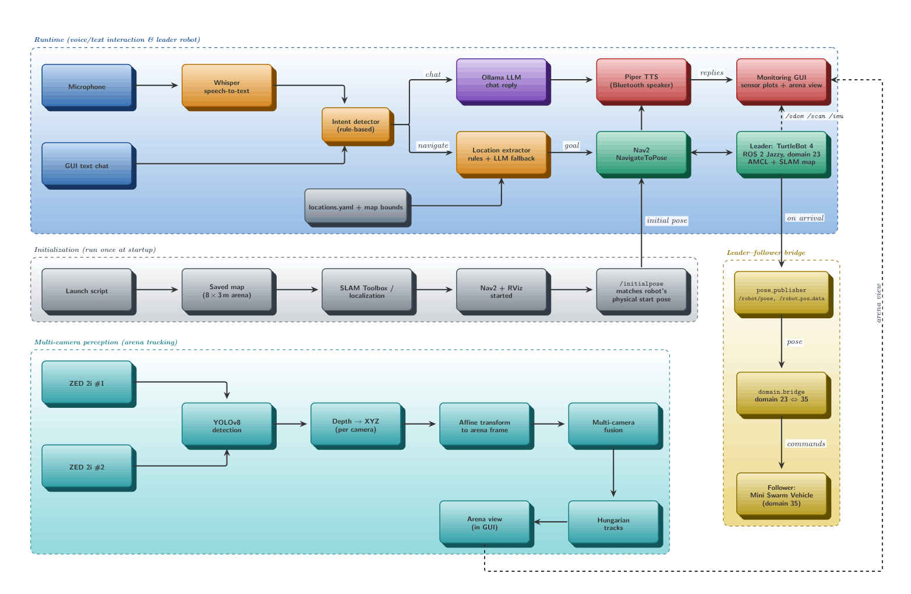
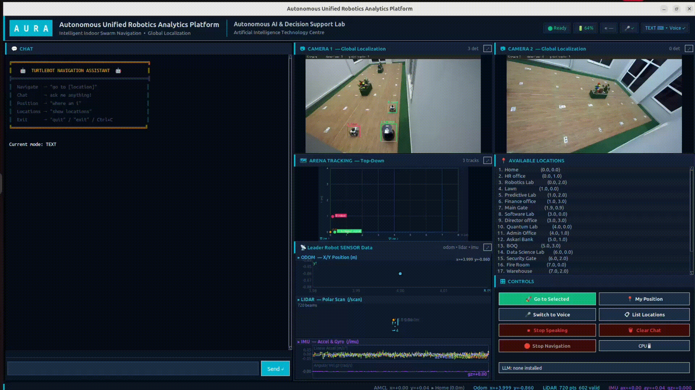

# Multi-Robot Navigation & Tracking — TurtleBot 4 leader + mini swarm follower

Extension of [LLM-Based-Navigation-Using-Turtlebot4](https://github.com/Huzaifa-Rahim-Malik/LLM-Based-Navigation-Using-Turtlebot4)
to a **leader–follower, multi-robot setup** in an indoor arena. A TurtleBot 4 (the leader) is driven by
natural-language text/voice commands; two ceiling-mounted ZED 2i cameras track every robot in arena
coordinates; and the leader publishes its arrival position so the custom
[Mini Swarm Vehicle](https://github.com/Huzaifa-Rahim-Malik/Mini_Swarm_vehicle) (the follower) can be sent to it.

<p align="center"> <br> </p>

The base project has **no camera feed and no object tracking**. This repo adds exactly that, plus the pose
hand-off to the second robot. Everything that is only about LLM/STT/TTS evaluation, result videos, install
scripts and the Piper voice model stays in the base repo.

## Updated Area

| Area |  What it adds |
|---|---|
| Global tracking | Two ZED 2i cameras → YOLOv8 detection → depth (XYZ) → affine transform to arena (x, y) → cross-camera fusion → Hungarian matching to persistent global track IDs (same ID survives camera hand-off) |
| Calibration | Click-based capture of (arena x,y) ↔ (ZED X,Y,Z) pairs per camera; the tracker fits the affine transform from them |
| Detector |  2-class YOLOv8 model trained for the ZED views |
| Robot → follower hand-off |  `/robot/pose` (10 Hz) and `/robot_pos_data` (`"x:<val> y:<val>"`, published once on arrival) |
| Multi-robot GUI |  3-column Tk GUI: chat · Camera 1 / arena tracking / leader sensor data (`/odom`, `/scan`, `/imu`) · Camera 2 / locations / controls |
| Cross-domain link | Bridges `/robot_pos_data` between ROS domain 23 (leader) and 35 (follower side) |

## Architecture
The system has four parts: **initialization** (run once), the **runtime** voice/text pipeline driving the
leader, the **leader–follower bridge**, and **multi-camera perception**.

<p align="center">  </p>

### 1. Initialization (run once at startup)

Launch script → saved map of the 8 × 3 m arena → SLAM Toolbox / localization → Nav2 + RViz →
`/initialpose`. The initial pose **must match the robot's physical start pose**, otherwise localization
and goals will be offset.

### 2. Runtime (voice/text → leader robot)

- **Input:** commands arrive by microphone (through **Whisper** speech-to-text) or by the GUI text chat.
- **Intent detector (rule-based):** decides whether the message is *chat* or *navigate*. Chat goes to the
  **Ollama LLM**, which writes a reply. Navigate goes to the location extractor.
- **Location extractor:** finds the destination with rules first and the **Ollama LLM as a fallback**. Named
  places are resolved from `src/locations.yaml` together with the map bounds, and the result is sent to
  Nav2 as a goal.
- **Navigation:** **Nav2** (`NavigateToPose`) drives the **leader TurtleBot 4**, which localizes with AMCL
  on the SLAM-built map.
- **Voice output:** **Piper TTS** speaks the chat reply and the navigation status through a Bluetooth
  speaker. The same replies are shown in the **Monitoring GUI**, together with the leader's `/odom`,
  `/scan` and `/imu` plots.

### 3. Leader–follower bridge

The leader runs ROS 2 Jazzy on **domain 23**; the follower Mini Swarm Vehicle is on **domain 35**.
On arrival, `pose_publisher` publishes `/robot/pose` and `/robot_pos_data` (`"x:<val> y:<val>"`), and
`domain_bridge` forwards `/robot_pos_data` between domains 23 and 35 so the follower can be sent to the
leader's position.

### 4. Multi-camera perception

Two **ZED 2i** cameras feed **YOLOv8** detection. Each detection is converted to XYZ with depth, mapped
into the common arena frame with a per-camera **affine transform**, **fused** across cameras and matched
over time with the **Hungarian** algorithm to give persistent global track IDs. The tracks are drawn in the
arena view of the Monitoring GUI.

The follower's own ROS-side code is not part of this repo; its hardware, Altium design and Arduino firmware
are in the Mini_Swarm_vehicle repo.

## Repository layout

```
Results/        Demo and GUI videos
config/     cam1_points.json, cam2_points.json     camera ↔ arena calibration points
models/     yolov8_zed_2class.pt
maps/       robotic_arena.pgm / .yaml              map used by this setup
tools/      calibrate_capture.py
ros/        env.sh, fastdds_pc.example.xml, cyclonedds_pc.xml, domain_bridge.yaml
```

## Requirements

- Ubuntu 24.04, ROS 2 Jazzy, TurtleBot 4 with Nav2 + SLAM Toolbox, `ros-jazzy-domain-bridge`
- 2 × ZED 2i with the Stereolabs ZED SDK and `pyzed`
- Ollama server (for the LLM fallback), NVIDIA GPU recommended for YOLO + Whisper
- `pip install -r requirements.txt`

## Quick start

```bash
# 1. Start the robot stack (base repo: scripts/robot_launch.sh), then:
cd src
python3 gui.py                    # GUI + dual-camera tracking
python3 gui.py --text-only        # no voice
# python3 main.py                 # terminal only

# 2. Hand-off to the follower domain (separate terminal)
ros2 run domain_bridge domain_bridge ros/domain_bridge.yaml
```
### Camera calibration (once per camera, or after moving a camera)

```bash
python3 tools/calibrate_capture.py --serial 35090194 --output config/cam1_points.json
python3 tools/calibrate_capture.py --serial 31496664 --output config/cam2_points.json
```

Enter 8–12 arena marker coordinates, then click each marker in the ZED image in the same order.
The ZED serial numbers are set in `src/gui.py` (`CameraWorker(0, 35090194, ...)`) and as the defaults in
`src/dual_camera_tracker.py`; change them for your cameras.

## ROS interfaces published by the leader

| Topic | Type | When |
|---|---|---|
| `/robot/pose` | `geometry_msgs/PoseWithCovarianceStamped` | 10 Hz, frame `map` |
| `/robot_pos_data` | `std_msgs/String`, `"x:<val> y:<val>"` | once on arrival, using the goal coordinates (falls back to the live AMCL pose) |

The leader's `/odom`, `/scan` and `/imu` are consumed by the GUI sensor panel.

## Demo 
**GUI**

<p align="center"> 
</p>

**Real Time Camera Tracking**

<p align="center"> </p>

## Known limitations
- Arena goals (`src/locations.yaml`) and the map are specific to the original lab.
- Camera serial numbers are hard-coded (see above).

## Author
This project is done by the following team members
- Dr. Muhammad Ahmad Kamran (Team Lead), AITeC Islamabad
- Muhammad Huzaifa Rahim Malik (TurtleBot4 Algorithm Design + GUI Development), AITeC Islamabad
- Muhammad Awais Khan (Mini Swarm Vehicle Algorithm Design), AITeC Islamabad
- Muhammad Rizwan (Camera Tracking Algorithm Design), AITeC Islamabad
